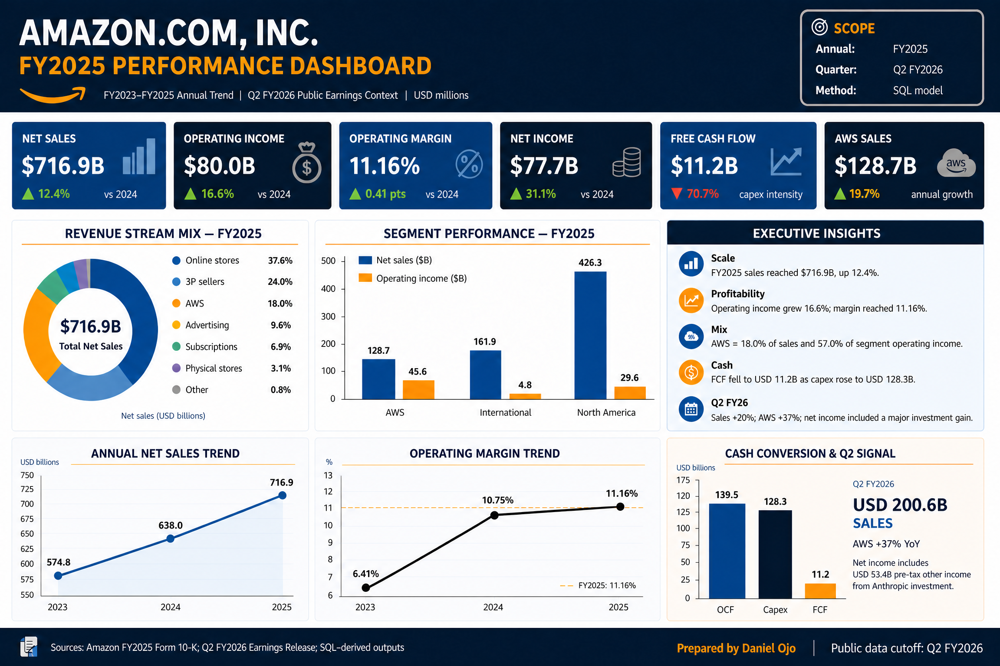
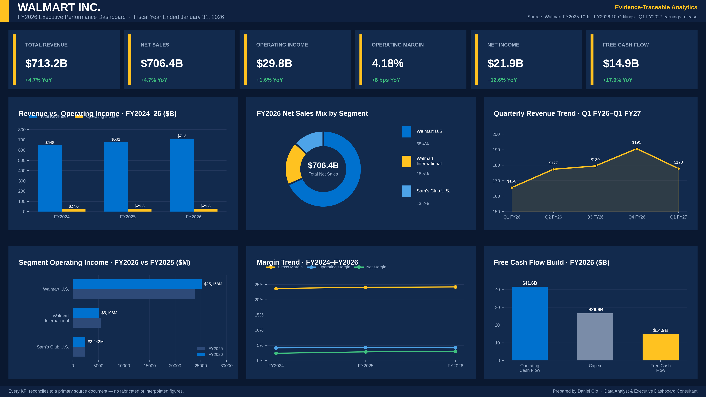
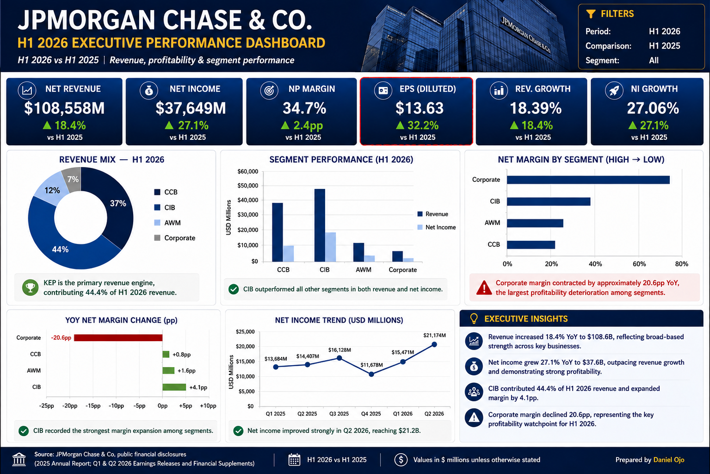
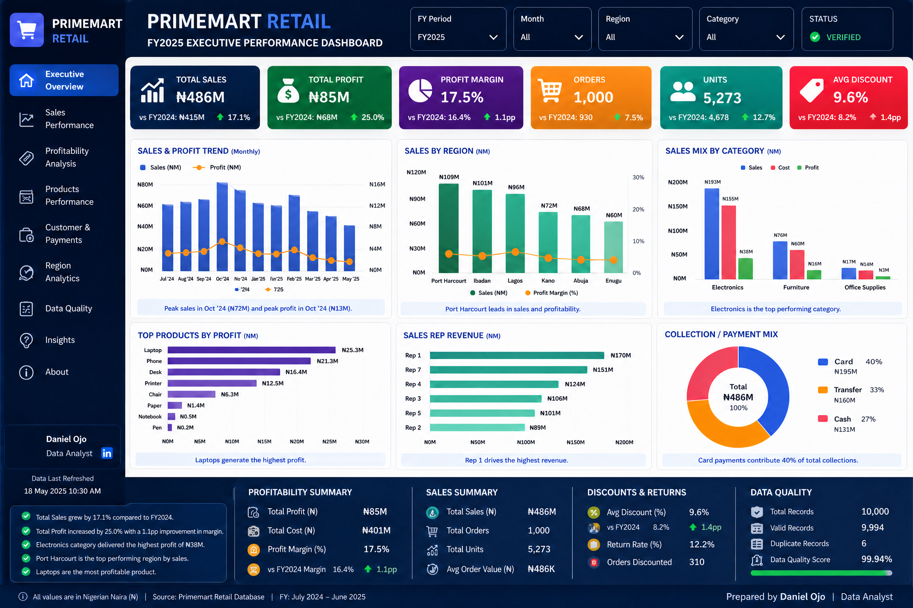
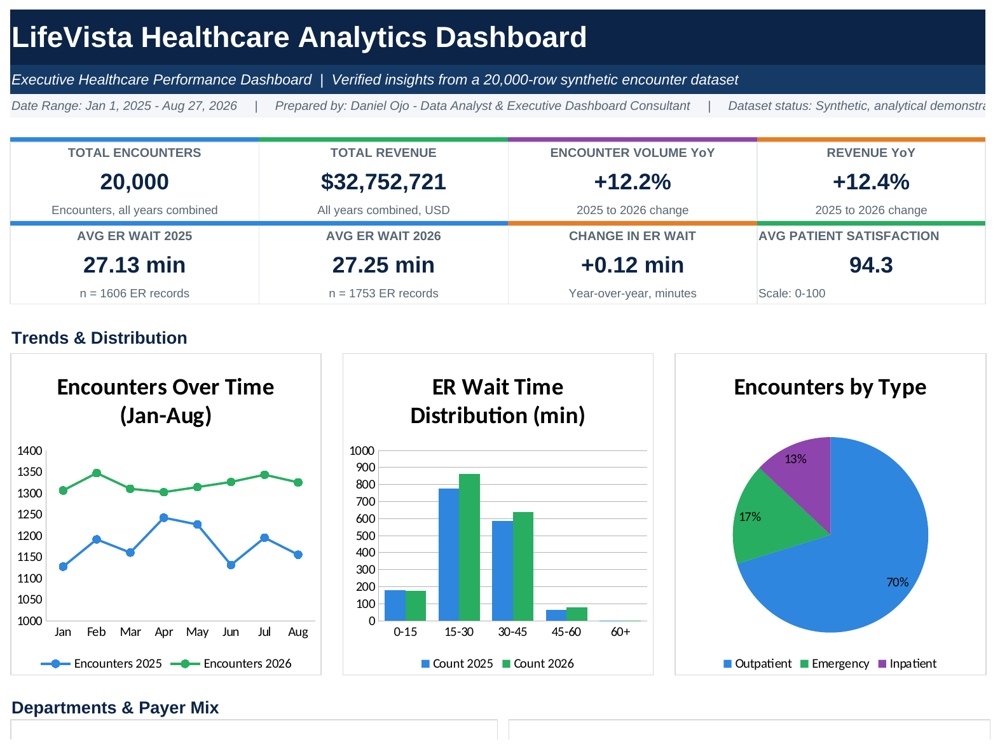
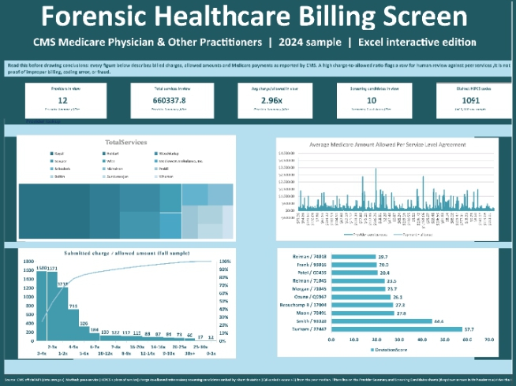

## Data Analytics Portfolio

A collection of end-to-end analytics projects covering SQL modeling, financial analysis, executive dashboarding, and anomaly detection. 

## 📊 Projects

| Project | Description | Stack |
|---|---|---|
| [01. Amazon SQL Financial Analytics](#01-amazon-sql-financial-analytics) | SQL-led financial model and executive dashboard analyzing FY2023–FY2025 performance, segment economics, and cash flow. | SQLite, SQL, Python, Excel |
| [02. Walmart Financial Dashboard](#02-walmart-financial-dashboard) | Public-data financial analysis (FY2025–FY2026) with KPI extraction, market reaction, and boardroom reporting. | Excel, Public Filings |
| [03. JPMorgan Executive Dashboard](#03-jpmorgan-executive-dashboard) | H1 2026 performance dashboard analyzing segment revenue, margins, and ROE/ROTCE. | Excel, Public Filings |
| [04. PrimeMart Retail Dashboard](#04-primemart-retail-dashboard) | FY2025 retail dashboard covering profitability, category economics, discount exposure, and sales rep performance. | Excel, Pivot Tables |
| [05. Lifevista Healthcare Dispensary](#05-lifevista-healthcare-dispensary) | Pharmacy operations and dispensary performance dashboard tracking inventory, sales, and patient metrics. | Power BI / Excel |
| [06. Forensic Healthcare Billing](#06-forensic-healthcare-billing) | Peer-group anomaly screening for healthcare billing using Excel-based dashboards and Python pipelines. | Python, pandas, Excel |

---

## 01. Amazon SQL Financial Analytics
**Objective:** Analyze Amazon's FY2023–FY2025 financial performance using a SQL-led model to extract revenue growth, segment economics, and cash-flow insights. 
**Key Insights:** AWS drives 57% of operating income. Free cash flow compressed to $11.2B due to heavy capex ($128.3B).
**Methodology:** Data normalized into SQLite tables. KPI queries built with window functions (`LAG`, `SUM OVER`). QA validation script included in the root of this repo.

---

## 02. Walmart Financial Dashboard
**Objective:** Analyze Walmart's FY2025–FY2026 performance, segment growth (Walmart U.S., International, Sam's Club), and market reaction.
**Key Insights:** Revenue grew 4.7% to $713.2B, but operating income grew only 1.6%, showing margin pressure. Walmart U.S. generated 76.9% of segment operating income. WMT underperformed the S&P 500 on 4 of 5 recent earnings dates.
**Methodology:** Formula-driven Excel model extracting data from SEC 10-K and 10-Q filings.

---

## 03. JPMorgan Executive Dashboard
**Objective:** Evaluate JPMorgan's H1 2026 vs H1 2025 financial performance and segment economics (CCB, CIB, AWM, Corporate).
**Key Insights:** Revenue grew 18.4% YoY to $108.6B, and net income grew 27.1%. CIB was the primary revenue engine (44.4% of revenue). Corporate margin contracted by 20.6pp.
**Methodology:** Tidy long-format dataset pivoted into Excel summary tables, with native charts and dynamic KPI cards.

---

## 04. PrimeMart Retail Dashboard
**Objective:** Summarize FY2025 retail scale, profitability, and discount exposure across 1,000 transactions.
**Key Insights:** Total sales of ₦485.7M generated an 17.5% profit margin. Electronics led on profit (₦59.8M). 78.1% of all orders were discounted, with a 9.6% average discount rate.
**Methodology:** Pivot tables, dynamic SUMIFS, and executive dashboard design in Excel. 100% data quality validation.

---

## 05. Lifevista Healthcare Dispensary
**Objective:** Track dispensary operations, encounter volume, and patient metrics to improve healthcare profitability and efficiency.
**Key Insights:** Revenue and encounter volume both grew by over 12% YoY. Despite the higher patient volume, ER wait times remained stable (+0.12 min), and patient satisfaction stayed strong at 94.3/100. Outpatient visits accounted for 70% of total encounters.
**Methodology:** Analyzed a 20,000-row synthetic healthcare encounter dataset to build an executive dashboard tracking financial performance, ER wait time distributions, and department mix.

---

## 06. Forensic Healthcare Billing
**Objective:** Identify provider/service combinations whose submitted charges or charge-to-allowed ratios are unusually elevated relative to peer benchmarks.
**Key Insights:** Uses hierarchical peer fallback (HCPCS + Type + State), services-weighted benchmarks, and robust z-scores to flag anomalies. It focuses on "traceability before intelligence" — every number traces back to a source row.
**Methodology:** Built an interactive Excel dashboard (shown below) backed by a Python/pandas data pipeline. The full pipeline includes 18 passing tests, a data dictionary, and a methodology document. 
[View the full code and tests on GitHub](https://github.com/Daniel38215571/forensic-healthcare-billing-screen).

---
## Author
**Daniel Ojo** — Data & AI Engineer
[LinkedIn](https://linkedin.com/in/daniel-ojo-879273197) · [GitHub](https://github.com/Daniel38215571)
